<!-- Header -->
<p align="center">
  
</p>

<p align="center">
  
</p>

<p align="center">
    
  </a>
  <a href="https://github.com/pauloricardoodev-dotcom">
    
  </a>
</p>

---

##  Sobre mim



```js
const paulo = {
  formacao:  "Engenharia de Software @ Unicesumar",
  foco:      "Front-End Developer",
  stack:     ["React", "NestJS", "PostgreSQL", "Tailwind"],
  hobbies:   ["speedcubing 🧩", "game dev 🎮"],
  motto:     "Com grandes poderes vêm grandes responsabilidades",
};
```

- 🎓 Estudante de **Engenharia de Software** na Unicesumar
- 💻 Construindo interfaces com **React** e APIs com **NestJS**
- 🎮 Nas horas vagas, criando jogos com **Unity** e **C#**
- 🧩 Resolvo cubo mágico, e aplico a mesma lógica nos bugs: um passo de cada vez

<br clear="right" />

---

##  Tecnologias

**Web fundamentos**
<p>
  
</p>

**Front-End**
<p>
  
</p>

**Back-End & Banco de dados**
<p>
  
</p>

**Game Dev**
<p>
  
</p>

---

##  Estatísticas

<p align="center">
  
  
</p>

<p align="center">
  
</p>

<p align="center">
  
</p>

---

##  Fora do código

| | |
|:-:|:--|
| 🕷️ | **Homem-Aranha**: "com grandes poderes vêm grandes responsabilidades", inclusive em produção |
| 🗡️ | **Hollow Knight**: paciência para explorar cada canto de Hallownest (e de cada codebase) |
| 👽 | **Dandadan**: time Okarun |
| 🧩 | **Cubo mágico**: algoritmos fora da tela também contam |

<!-- Footer -->
<p align="center">
  
</p>
